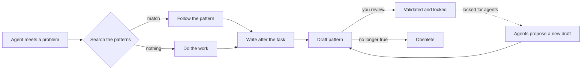

# OPS Memory: give your AI agents a memory that survives

**License: [PolyForm Noncommercial 1.0.0](LICENSE). Non-commercial use only.** For commercial use: didierjean@gnetics.ca.

Your agents forget. A new conversation, a compacted context, a different agent, and they start from zero, asking you to explain the same thing again.

**OPS Memory fixes that.** It is a small service on your own server where your agents keep what they learn as **patterns**: one problem, its exact symptom, its cause, its fix. Before they act, they search it. After every task, they write to it. You decide what becomes a rule.

The author has run it every day since May 2026: **more than 8,000 patterns**, written and read by several agents. This repository is that system, rebuilt so you can have your own in minutes.

> **Trilogy "Work with your AI agent from your phone".** This is **part 2 of 3**.
> 1. **[The Door: Mobile Server Connection](https://github.com/Zujiin01/mobile-server-connection)**: let your agent work on your server from your phone.
> 2. **OPS Memory** (this repository): the pattern system your agents use as memory.
> 3. **[The Bridge](https://github.com/Zujiin01/the-bridge)**: your agents talk to each other and wake each other up, without you.
>
> Each part works on its own. Without the Door, your phone agents can already use the memory over its own HTTPS address. With the Door, they can also work on the server, and the memory tells them what was already learned about it.

**Contents:** [How it works](#how-it-works) · [Try it in 2 minutes](#try-it-in-2-minutes) · [A full cycle](#a-full-cycle-real-output) · [Review and validate](#review-and-validate-your-2-minutes-a-day) · [Connect your agent](#connect-your-agent) · [Why it works](#why-it-works) · [FAQ](#faq) · [Going live](#going-live-on-a-server) · [Limits](#known-limits)

## How it works



Three rules make the whole system, and they are patterns themselves (they come with the install): **1. search before acting. 2. write after every task. 3. load the recent patterns at the start of a session.**

A pattern looks like this. It is not a pile of notes: it has a category, the exact text of the symptom (what the next search will match), a cause and a fix.

```json
{
  "title": "Certificate renewal fails: port 80 closed",
  "category": "incident",
  "error_signature": "Timeout during connect (likely firewall problem)",
  "root_cause": "The HTTP challenge needs port 80 open.",
  "quick_fix": "Open port 80, renew, close it again if needed.",
  "root_fix": "Keep port 80 open and redirect it to HTTPS in nginx.",
  "tags": "certbot,https,firewall"
}
```

An agent finds it, reads it, follows it. And you can tell an agent "apply pattern 8" instead of explaining a whole procedure again.

## Try it in 2 minutes

You need Node 22.13 or newer. No server, no root, no nginx.

```bash
git clone https://github.com/Zujiin01/ops-memory.git && cd ops-memory
npm install
npm run try     # prepares a local trial: 10 starter patterns and two keys (agent and owner)
npm start       # keep it running, then use the curl commands printed by "npm run try" in another terminal
```

Port 3500 busy? Change `"port"` in `config.json`. Lost the keys? `rm -rf config.json data && npm run try`. On Windows PowerShell, write `curl.exe` instead of `curl`.

## A full cycle (real output)

Set these first (the keys are printed by `npm run try`): `B=http://127.0.0.1:3500/api/v1/memory`, `KA=<the agent key>`, `KO=<the owner key>`. Output is shortened.

```
$ curl -H "Authorization: Bearer $KA" "$B/search?q=502+nginx"
{"query":"502 nginx","count":0,"patterns":[]}                         # nothing known yet: do the work

$ curl -X POST $B -H "Authorization: Bearer $KA" -H "Content-Type: application/json" \
    -d '{"title":"nginx 502 after reload: backend not listening","category":"incident","error_signature":"502 Bad Gateway",...}'
{"id":11,"similar":[]}                                                 # written after the task, as a draft

$ curl -X POST $B ... -d '{"title":"502 after nginx reload","error_signature":"502 Bad Gateway"}'
{"id":12,"similar":[{"id":11,"title":"nginx 502 after reload: backend not listening"}],
 "note":"Similar patterns exist: if one covers the same subject, enrich it (PATCH) instead of keeping a duplicate."}

$ curl -X PATCH $B/11 -H "Authorization: Bearer $KA" ... -d '{"append":{"root_cause":"This time the environment file was missing."}}'
{"id":11,"updated":["root_cause"]}                                     # enriched, with date and author

$ curl -H "Authorization: Bearer $KO" "$B/recent?status=draft"         # you list what is waiting
$ curl -X POST $B/11/validate -H "Authorization: Bearer $KO" -H "Content-Type: application/json" -d '{"rev":2}'
{"id":11,"status":"validated"}                                         # validated and locked (a rule or instruction also reaches /boot)

$ curl -X PATCH $B/11 -H "Authorization: Bearer $KA" ... -d '{"append":{"root_cause":"x"}}'
{"error":"This pattern is validated: only the owner's admin key can change it. ..."}   # HTTP 403
```

## Review and validate (your 2 minutes a day)

Agents write drafts. Only your `admin` key validates a draft, so an agent can never change what is validated, or the rules, by itself.

```bash
# What is waiting?
curl -s -H "Authorization: Bearer $KO" "$B/recent?status=draft"
# Read one, with its revision number "rev"
curl -s -H "Authorization: Bearer $KO" "$B/11"
# Validate the exact version you read (refused with 409 if an agent edited it since)
curl -s -X POST -H "Authorization: Bearer $KO" -H "Content-Type: application/json" -d '{"rev":2}' "$B/11/validate"
# Retire a pattern that is no longer true (it is hidden from searches, never deleted)
curl -s -X POST -H "Authorization: Bearer $KO" -H "Content-Type: application/json" -d '{"reason":"Replaced by pattern 20"}' "$B/11/obsolete"
```

`/boot` serves only validated patterns of category `rule` or `instruction`. Other validated patterns (an incident, a lesson) are locked and rank higher in searches. To change a locked pattern, an agent creates a new draft titled "Proposed change to pattern N", and you merge or validate it.

## Connect your agent

Every agent needs the same two things: the [instructions](AGENT-INSTRUCTIONS.md) and its own key. Test with: "call /boot and list the numbers of the rules" (it must answer 1 to 9).

- **Claude, Grok, GrokBot (the author's name for his Grok agent) apps:** create a private project and paste the instructions into the project instructions. That is where the address and the key live.
- **The memory-first skill (optional):** it contains no address and no key. Copy the text of [`skills/memory-first/SKILL.md`](skills/memory-first/SKILL.md), give it to your agent and say: "Create a skill from this text". This works in any app that supports skills, mobile included. The skill only says "apply patterns 1, 2 and 3" and the agent reads them from the store.
- **Claude Code:** put the instructions in `CLAUDE.md`.
- **Cursor and other coding agents:** put the instructions in the project rules.
- **Your own agent (any API with function calling):** use [`tools/memory-tools.json`](tools/memory-tools.json), seven neutral tool definitions to convert to your provider's format.


## Why it works

- **Patterns, not notes.** The fixed shape makes them findable and followable. Search is full text, ranked: title and exact symptom count most.
- **A pattern is never finished.** When something changes, the agent adds to the existing pattern instead of starting a new one, so the store stays current instead of piling up.
- **It survives context compaction.** What mattered was written as a pattern during the work, so after a compaction the agent re-reads it instead of guessing from a summary.
- **It saves tokens and supervision.** Agents remember how they did things, so you explain and watch less. The author found that a mid-size model is usually enough once the memory is there.
- **Shared.** One key per agent or person, one store, and each pattern shows who wrote it (`author`) and who edited it last (`updated_by`).
- **Safe.** Secrets are refused, drafts and rules are separate, validated patterns are locked, the service has no way to run commands.

## FAQ

**Why not a vector database or RAG?** Patterns are short, titled and carry the exact error text, so ranked full-text search finds them without embeddings, an extra service or fuzzy results. It is one Node process and one SQLite file.

**Why not a `MEMORY.md` file?** One file grows until nobody reads it, cannot be searched by several agents at once, and has no author, no review and no lock.

**Why not the memory built into my AI app?** It belongs to one app, other agents cannot read it, and you cannot review or audit it. Here the memory is yours, on your server, shared by every agent you choose.

**When does it pay back?** The first time a problem comes back and the agent already knows the fix.

**Which agents?** See [Compatibility](#compatibility).

**Can a malicious or fooled agent rewrite the rules?** It can write drafts, never validated rules, and it cannot validate. The remaining risk is validating a draft without reading it: read before you validate (the `rev` check makes sure you validate what you read).

## What it does

| Route (under `/api/v1/memory`) | Scope | Purpose |
|---|---|---|
| `GET /boot` | read | validated rules (full text) and the latest patterns, once per session |
| `GET /search?q=` | read | 1 to 3 keywords. Optional: `category`, `project`, `limit`, `include_obsolete=1` |
| `GET /recent` | read | latest patterns. Optional: `category`, `project`, `status`, `limit` |
| `GET /<id>` | read | one pattern in full, with its `rev` |
| `POST /` | write | create a draft (answers with similar patterns) |
| `PATCH /<id>` | write | update a draft, or `append` dated text. Locked once validated or obsolete |
| `POST /<id>/occurrence` | write | the problem happened again (note ignored on locked patterns) |
| `POST /<id>/validate` | admin | validate a draft, with the `rev` you reviewed |
| `POST /<id>/obsolete` | admin | retire a pattern, with an optional `reason` |
| `GET /api/v1/health` | none | check that the service answers |

Inside: one SQLite file (the one built into Node, no native build), a full-text index with weighted ranking, exact matches first then a looser fallback. Dates are UTC.

Safeguards: secrets refused (the answer names the field, never the value); one key per agent; the program, config and keys belong to root and the service user can only write the database; audit lines on standard output (journald); rate limit per key; failed-login throttle; the service listens on `127.0.0.1` only, behind nginx and HTTPS.

## The starter patterns and the skill

The install loads **10 starter patterns** (numbers 1 to 10, in [`patterns-start/`](patterns-start)): search before acting, write after every task, load the recent ones at the start, never store a secret, one subject per pattern, refer by number, verify the real state, hand over between agents, survive a context compaction, and a blank template with a worked example.

The [`memory-first` skill](skills/memory-first/SKILL.md) is three lines: *apply patterns 1, 2 and 3*, with the address to fetch them. The agent reads the current text from the store, so you change the behaviour of all your agents by editing a pattern, not by pasting text everywhere.

## Compatibility

The agent needs a tool that can send web requests to your domain.

- **Works (used in practice):** Claude, Grok and GrokBot.
- **Does not work: the ChatGPT and Gemini mobile apps.** They do not expose the tool calls needed. This is a limit of those apps today.
- **Should work, not tested by the author:** ChatGPT and Gemini through their API with your own agent code ([`tools/memory-tools.json`](tools/memory-tools.json)).

## Going live on a server

You need a Linux server (Ubuntu), **Node 22.13 or newer** (system-wide), nginx and a domain name.

1. **DNS and firewall.** An `A` record for `memory.example.com`; only ports 22, 80 and 443 open.
2. **Install.**
   ```bash
   git clone https://github.com/Zujiin01/ops-memory.git && cd ops-memory
   sudo bash install/install.sh        # creates the "ops-memory" user, loads the 10 starter patterns
   curl -s http://127.0.0.1:3500/api/v1/health
   ```
3. **nginx and HTTPS.** Copy `nginx/memory.conf.example` to `/etc/nginx/sites-available/ops-memory`, put your domain in it, enable it (`sudo ln -s /etc/nginx/sites-available/ops-memory /etc/nginx/sites-enabled/`), then `sudo certbot --nginx -d memory.example.com` (it adds the certificate and HTTPS), then `sudo nginx -t && sudo systemctl reload nginx`.
4. **Keys**, as root, one per agent. Yours has the `admin` scope:
   ```bash
   sudo MEMORY_CONFIG=/opt/ops-memory/config.json node --no-warnings /opt/ops-memory/bin/newkey.js --name owner --scopes admin
   sudo MEMORY_CONFIG=/opt/ops-memory/config.json node --no-warnings /opt/ops-memory/bin/newkey.js --name claude-phone --scopes read,write
   ```
   A key is shown **only once**. List with `--list`, revoke with `--revoke <id>`.
5. **Connect the agent** ([above](#connect-your-agent)) and run the test.
6. **Back up** the database: `sudo MEMORY_CONFIG=/opt/ops-memory/config.json node --no-warnings /opt/ops-memory/bin/backup.js /root/ops-memory-$(date +%F).db`

**Never open port 3500 directly**: only nginx, over HTTPS. A team or a family works the same way: one key per person or agent, one store.

## Known limits

- Search is full text (words and prefixes), not semantic. A good title and the exact error text in `error_signature` matter most.
- Nothing forces an agent to follow the rules: they are instructions. Check now and then that your agents really search first.
- A pattern is a memory of the past and can be stale. That is why pattern 7 tells agents to check the real state, and why you can retire patterns.
- Secret detection is a safety net, not a guarantee: it catches the common formats but not all (some cloud providers' keys, encoded values). Never put a secret in a pattern; describe where it lives.
- A process running on the server itself can send a fake `X-Real-IP` straight to port 3500 and falsify the address in the audit log. Behind nginx, outside clients cannot (nginx overwrites the header).
- One instance, no high availability, no accounts or web interface.

## Test

```bash
npm install
npm test        # starts the service on a temporary database and checks every route
```

## License: non-commercial use only

[PolyForm Noncommercial 1.0.0](LICENSE), copyright Technologies GNETICS Inc.

- **Allowed**: use, study, modify and share this code for **non-commercial** purposes: personal use, learning, research, hobby projects, non-profit organizations, educational institutions.
- **Forbidden without written permission**: using it in a business, a paid product or service, reselling it, hosting it for customers, or building it into a commercial offer.
- If you share a copy or a modified version, you must include the license and the copyright notice.
- This is **source-available** code, not "open source" in the strict sense (it forbids commercial use).

For commercial use, write to Technologies GNETICS Inc.: didierjean@gnetics.ca.

This software is provided as is, without warranty. You are responsible for what your agents do with what they read in it.
